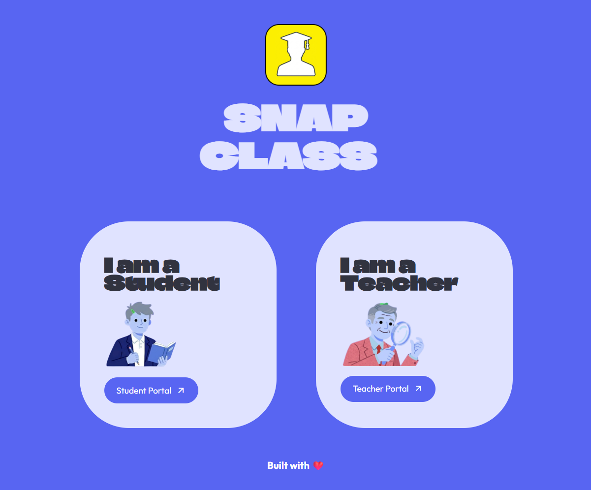
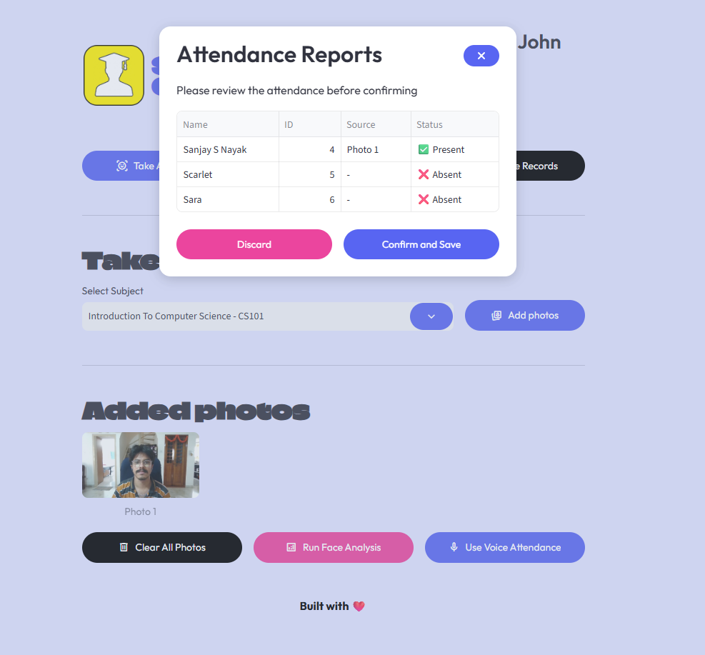
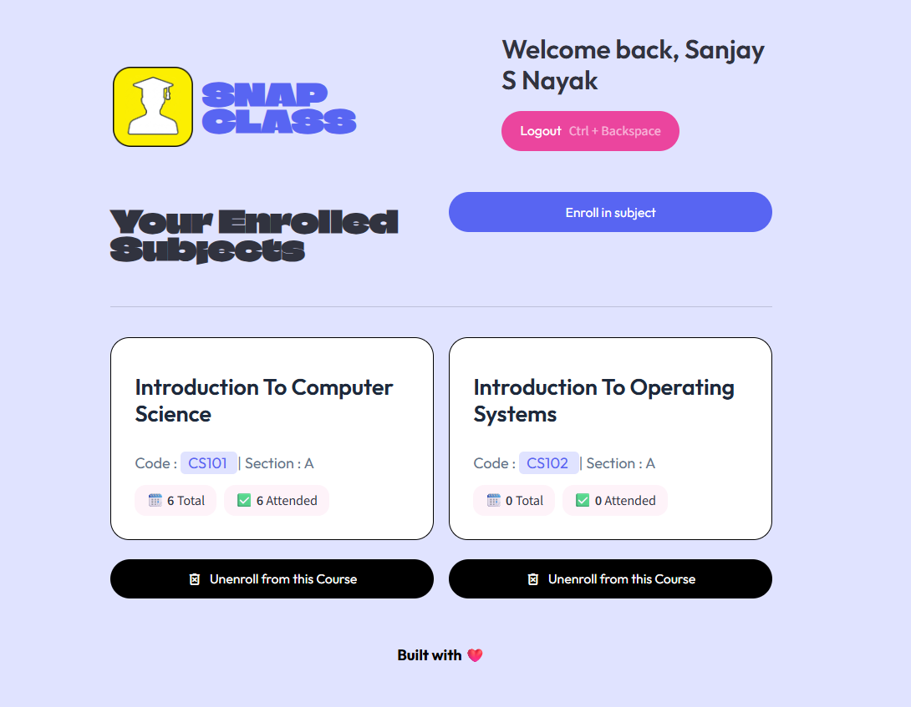

<p align="center">
  
</p>

<h1 align="center">SnapClass &mdash; Landing Page</h1>

<p align="center">
  The official showcase and onboarding portal for <b>SnapClass</b>, the AI-powered classroom attendance platform.
</p>

<p align="center">
  <a href="https://snap-class-landing-page-self.vercel.app/"></a>
  <a href="https://snapclass-take-attendance-using-ai.streamlit.app/"></a>
  <a href="https://github.com/sanjaynayak1224/SnapClass_Making-Attendance-faster-using-AI"></a>
  
  
</p>

---

## 🔗 Quick Links

- **Live Landing Page (Vercel):** [https://snap-class-landing-page-self.vercel.app/](https://snap-class-landing-page-self.vercel.app/)
- **Live Attendance Application (Streamlit Cloud):** [https://snapclass-take-attendance-using-ai.streamlit.app/](https://snapclass-take-attendance-using-ai.streamlit.app/)
- **Core App Repository:** [sanjaynayak1224/SnapClass_Making-Attendance-faster-using-AI](https://github.com/sanjaynayak1224/SnapClass_Making-Attendance-faster-using-AI)

---

## 💡 Why I Built This

When I developed the SnapClass AI attendance system, I realized that jumping straight into a biometric camera tool can be confusing for teachers and students seeing it for the first time. Taking roll call in colleges usually eats up 10 to 15 minutes of lecture time and still suffers from proxies. Biometrics fix both problems, but only if people understand how simple the workflow really is.

I built this landing page as the front door for the project. It gives teachers and students a clear visual tour of the entire process—from capturing a single classroom photo or recording sequential roll calls, to scanning course QR codes and viewing real-time attendance analytics—before launching straight into the live application.

---

## 🎨 Design & Aesthetic Highlights

I wanted the landing page to look editorial, bold, and distinct from cookie-cutter SaaS templates:

- **Typography:** Paired the retro-display typeface `Climate Crisis` for headers with the clean geometric `Outfit` font for body content.
- **Color Palette:** Built on a brand indigo (`#5865F2`), soft lilac canvas (`#F0F4FF`), dark obsidian accents, and vibrant highlight badges (`#EB459E`).
- **Real Visuals:** Every showcase card displays actual screenshots taken from running sessions of the Streamlit application.
- **Glass & Depth:** Floating hero cards, subtle borders, and smooth transitions when moving across sections.

---

## 📸 Page Sections & Walkthrough

Here is what I have structured across the landing page:

### 1. Hero Section
Features direct call-to-action buttons that launch the live attendance tool, flanked by floating preview cards showing the live attendance report and the role-selection home screen.

<p align="center">
  
</p>

### 2. Core Features Breakdown
Summarizes the three main technical pillars of the platform:
- **📸 Multi-Face Recognition:** Identifying all students in a single group photo using 128-dimensional deep face descriptors and Support Vector Classification.
- **🎙️ Sequential Voice ID:** Matching voice utterances against stored 256-dimensional speaker embeddings when students call out "Present".
- **📱 QR-Driven Roster:** Automatic classroom enrollment through dynamically generated QR codes and course join links.

### 3. The Teacher's Journey (Step-by-Step)
Takes educators through the end-to-end workflow:
1. **Secure Login:** Encrypted authentication backed by bcrypt and PostgreSQL.
2. **Interactive Dashboard:** Central hub for all assigned courses, active student rosters, and previous logs.
3. **Course Management:** Setting up subject codes (e.g. `CS101`), course titles, and sections in seconds.
4. **FaceID Attendance:** Capturing room snapshots via webcam or file upload to mark present students automatically.
5. **VoiceID Attendance:** Recording continuous classroom audio and splitting speech segments to recognize attendees.
6. **Actionable Records:** Browsing historical records, attendance rates, and session logs.

<p align="center">
  
</p>

### 4. The Student's Journey
Shows the student experience:
1. **Instant Enrollment:** Scanning a course QR code or clicking a shared join link.
2. **Biometric Registration:** One-time face scan and voice sample registration directly from their browser.
3. **Personal Dashboard:** Real-time visibility into overall percentage, classes attended, and total sessions held.

<p align="center">
  
</p>

### 5. Tech Stack Showcase
Highlights the underlying technologies powering the backend, computer vision pipeline, voice encoder, and database.

---

## 🛠️ Tech Stack

- **Backend:** [Python](https://www.python.org/) & [Flask](https://flask.palletsprojects.com/)
- **Live Reload / Dev Server:** [Livereload](https://pypi.org/project/livereload/)
- **Styling:** Semantic HTML5 & Modern Vanilla CSS3 (CSS Variables, Flexbox, CSS Grid)
- **Typography:** Google Fonts (`Climate Crisis`, `Outfit`)
- **Deployment Platform:** [Vercel](https://vercel.com/)
- **Integrated Application:** [Streamlit](https://streamlit.io/) + [Supabase](https://supabase.com/)

---

## 📂 Project Structure

```text
Snapclass_Frontend/
├── static/
│   ├── css/
│   │   └── styles.css          # Core stylesheet, variables, and responsive layout
│   └── img/
│       ├── logo.png            # SnapClass vector/PNG logo
│       └── demo/               # UI preview screenshots used in the showcase
│           ├── Attendance_Records.png
│           ├── Attendance_Report.png
│           ├── Course_Assignment.png
│           ├── Home.png
│           ├── Instant_Enrollment.png
│           ├── Interactive_Dashboard.png
│           ├── Personal_Dashboard.png
│           ├── Quick_Enrollment.png
│           ├── Secure_Login.png
│           └── Voice_Attendance.png
├── templates/
│   └── index.html              # Main landing page template
├── .gitignore                  # Git ignore rules
├── app.py                      # Flask application entry point
├── README.md                   # Project documentation
└── requirements.txt            # Python dependencies (flask, livereload)
```

---

## 🚀 Getting Started Locally

If you would like to run this landing page on your local machine or tweak the styling, follow these steps:

### 1. Prerequisites
- Python 3.10 or higher installed on your system.
- Git installed.

### 2. Clone the Repository
```bash
git clone https://github.com/sanjaynayak1224/SnapClass_Landing_Page.git
cd SnapClass_Landing_Page
```

### 3. Set Up a Virtual Environment
```bash
# On Windows (PowerShell)
python -m venv venv
.\venv\Scripts\Activate.ps1

# On macOS/Linux
python3 -m venv venv
source venv/bin/activate
```

### 4. Install Dependencies
```bash
pip install -r requirements.txt
```

### 5. Run the Application
```bash
python app.py
```

The Flask server will start locally. Open your browser and navigate to:
```text
http://127.0.0.1:5000/
```

### 6. Live Reloading (Optional for Development)
If you are modifying `styles.css` or `index.html` and want hot-reloading on file save, you can run:
```python
from livereload import Server
from app import app

server = Server(app.wsgi_app)
server.watch('templates/*')
server.watch('static/css/*')
server.serve(port=5000, debug=True)
```

---

## ☁️ Deployment on Vercel

This landing page is deployed on **Vercel**. To deploy your own fork:

1. Push your repository to GitHub.
2. Sign in to [Vercel](https://vercel.com/) and click **"Add New Project"**.
3. Import your `SnapClass_Landing_Page` repository.
4. If deploying as a Python WSGI app, configure your `vercel.json` with the python runtime:
   ```json
   {
     "rewrites": [
       { "source": "/(.*)", "destination": "/app.py" }
     ]
   }
   ```
5. Click **Deploy**. Vercel will build and assign an SSL-secured production URL.

---

## 🤝 Related Project

This landing page showcases the full **SnapClass AI Attendance System**. To explore the core machine learning models, database queries, and Streamlit application, visit:

- **App Repository:** [https://github.com/sanjaynayak1224/SnapClass_Making-Attendance-faster-using-AI](https://github.com/sanjaynayak1224/SnapClass_Making-Attendance-faster-using-AI)
- **Live Streamlit App:** [https://snapclass-take-attendance-using-ai.streamlit.app/](https://snapclass-take-attendance-using-ai.streamlit.app/)

---

## 👤 Author

**Sanjay S Nayak**
- GitHub: [@sanjaynayak1224](https://github.com/sanjaynayak1224)
- Project: [SnapClass AI Attendance System](https://snapclass-take-attendance-using-ai.streamlit.app/)

---

## 📄 License

This project is licensed under the [MIT License](LICENSE). Feel free to use it, modify it, and build upon it!
